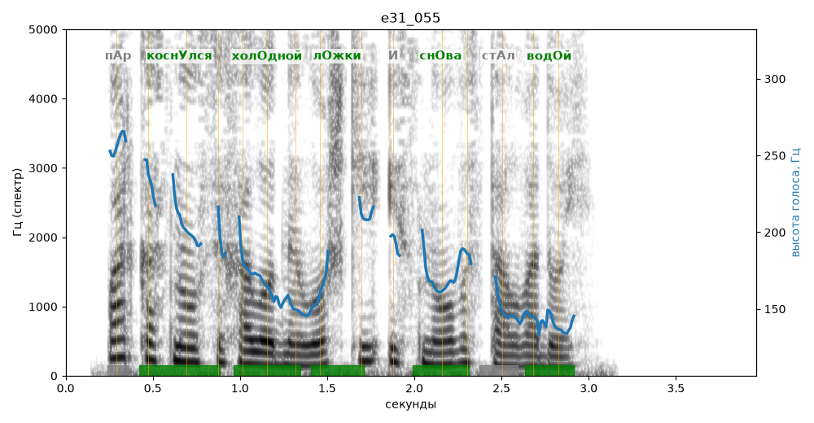

# e31_055

Голос: **edge:ru-RU-SvetlanaNeural** · длительность 4.0 с
Естественность (UTMOS): **3.91 из 5** (живой диктор ≈ 4–4.5)
Эталон: Пар коснулся холодной ложки и снова стал водой.
Распознано: Парк оснулся холодной ложкой и снова стал водой.
Расхождения в словах: «пар коснулся» → «парк оснулся»; «ложки» → «ложкой»

## Ударения
(где нужно: ruaccent)

| слово | нужно | у голоса | |
|---|---|---|---|
| коснулся | коснУлся | коснУлся | ✓ |
| холодной | холОдной | холОдной | ✓ |
| ложки | лОжки | лОжки | ✓ |
| снова | снОва | снОва | ✓ |
| водой | водОй | водОй | ✓ |

## Интонация
- ✓ «пар коснулся холодной ложки и снова стал водой.» — конец фразы понижается — звучит законченно
- Диапазон голоса 10.3 полутонов (живо), средняя высота 167 Гц

## Паузы и темп
- паузы на своих местах
- Темп 6.0 слога/с (нормально)

_Синяя линия — высота голоса. Над словами заглавная буква — где ударение должно быть; красным — голос поставил не туда (уверенно), оранжевым — возможно._
