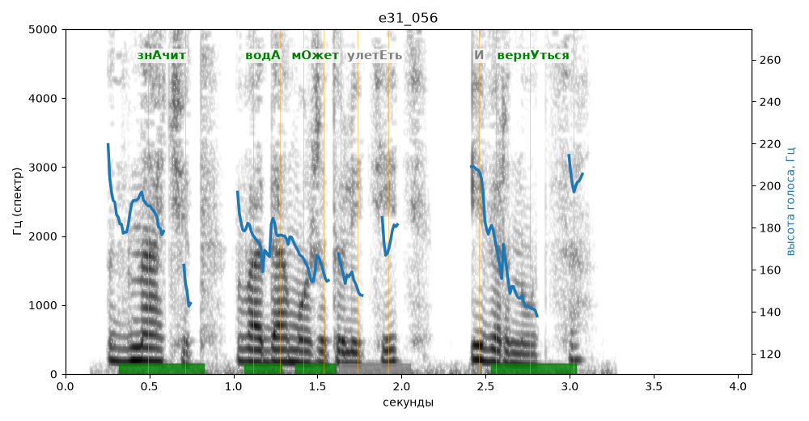

# e31_056

Голос: **edge:ru-RU-SvetlanaNeural** · длительность 4.1 с
Естественность (UTMOS): **3.78 из 5** (живой диктор ≈ 4–4.5)
Эталон: Значит, вода может улететь — и вернуться?
Распознано: Значит, вода может улететь и вернуться.
Слова: все совпали

## Ударения
(где нужно: ruaccent)

| слово | нужно | у голоса | |
|---|---|---|---|
| значит | знАчит | знАчит | ✓ |
| вода | водА | водА | ✓ |
| может | мОжет | мОжет | ✓ |
| улететь | улетЕть | Улететь | ? не разобрать |
| вернуться | вернУться | вернУться | ✓ |

## Интонация
- ✓ «значит вода может улететь и вернуться?» — вопросительный подъём на слове «и»
- Диапазон голоса 6.3 полутонов (нормально), средняя высота 175 Гц

## Паузы и темп
- паузы на своих местах
- Темп 6.3 слога/с (нормально)

_Синяя линия — высота голоса. Над словами заглавная буква — где ударение должно быть; красным — голос поставил не туда (уверенно), оранжевым — возможно._
