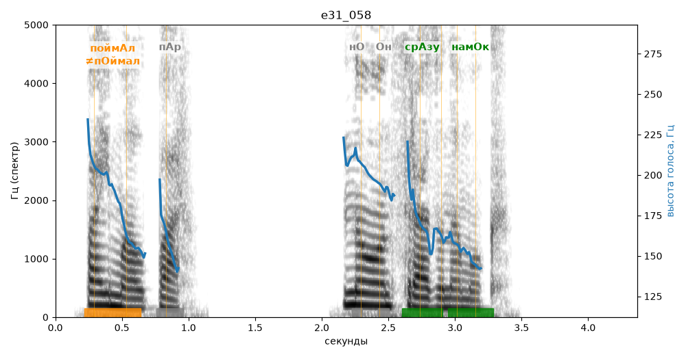

# e31_058

Голос: **edge:ru-RU-SvetlanaNeural** · длительность 4.4 с
Естественность (UTMOS): **4.18 из 5** (живой диктор ≈ 4–4.5)
Эталон: Поймал пар. Но он сразу намок.
Распознано: Поймал пар. Но он сразу намок.
Слова: все совпали

## Ударения
(где нужно: ruaccent)

| слово | нужно | у голоса | |
|---|---|---|---|
| поймал | поймАл | пОймал | ✗? возможно — послушать |
| сразу | срАзу | срАзу | ✓ |
| намок | намОк | намОк | ✓ |

## Интонация
- ✓ «поймал пар.» — конец фразы понижается — звучит законченно
- ✓ «но он сразу намок.» — конец фразы понижается — звучит законченно
- Диапазон голоса 6.6 полутонов (нормально), средняя высота 173 Гц

## Паузы и темп
- паузы на своих местах
- Темп 5.0 слога/с (нормально)

_Синяя линия — высота голоса. Над словами заглавная буква — где ударение должно быть; красным — голос поставил не туда (уверенно), оранжевым — возможно._
