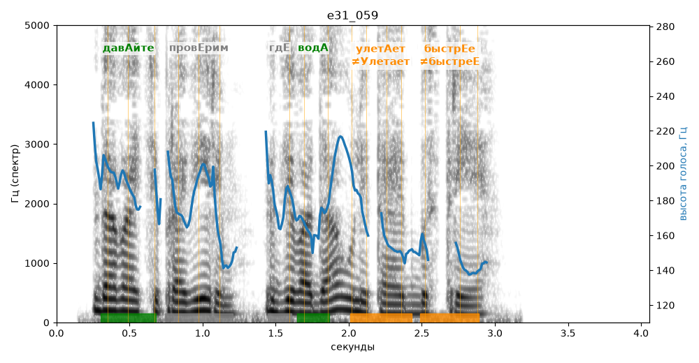

# e31_059

Голос: **edge:ru-RU-SvetlanaNeural** · длительность 4.1 с
Естественность (UTMOS): **3.72 из 5** (живой диктор ≈ 4–4.5)
Эталон: Давайте проверим, где вода улетает быстрее.
Распознано: Давайте проверим, где вода улетает быстрее.
Слова: все совпали

## Ударения
(где нужно: ruaccent)

| слово | нужно | у голоса | |
|---|---|---|---|
| давайте | давАйте | давАйте | ✓ |
| проверим | провЕрим | прОверим | ? не разобрать |
| вода | водА | водА | ✓ |
| улетает | улетАет | Улетает | ✗? возможно — послушать |
| быстрее | быстрЕе | быстреЕ | ✗? возможно — послушать |

## Интонация
- ✓ «давайте проверим где вода улетает быстрее.» — конец фразы понижается — звучит законченно
- Диапазон голоса 6.8 полутонов (нормально), средняя высота 173 Гц

## Паузы и темп
- паузы на своих местах
- Темп 6.8 слога/с (быстро)

_Синяя линия — высота голоса. Над словами заглавная буква — где ударение должно быть; красным — голос поставил не туда (уверенно), оранжевым — возможно._
