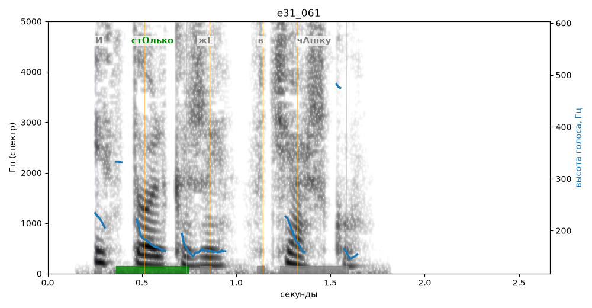

# e31_061

Голос: **edge:ru-RU-SvetlanaNeural** · длительность 2.7 с
Естественность (UTMOS): **3.86 из 5** (живой диктор ≈ 4–4.5)
Эталон: И столько же — в чашку.
Распознано: И столько же в чашку.
Слова: все совпали

## Ударения
(где нужно: ruaccent)

| слово | нужно | у голоса | |
|---|---|---|---|
| столько | стОлько | стОлько | ✓ |
| чашку | чАшку | чашкУ | ? не разобрать |

## Интонация
- ✗ «и столько же в чашку.» — конец фразы не понижается — звучит незаконченно / как перечисление
- Диапазон голоса 13.8 полутонов (живо), средняя высота 167 Гц

## Паузы и темп
- паузы на своих местах
- Темп 6.4 слога/с (нормально)

_Синяя линия — высота голоса. Над словами заглавная буква — где ударение должно быть; красным — голос поставил не туда (уверенно), оранжевым — возможно._
