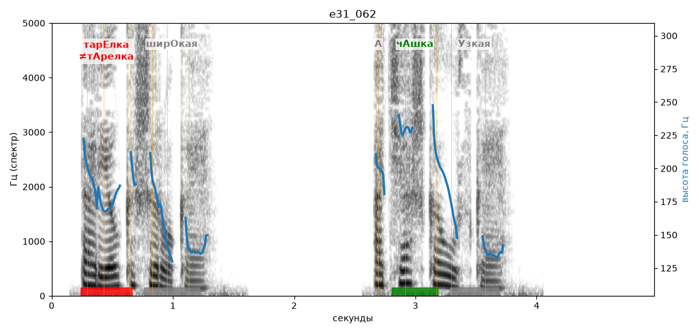

# e31_062

Голос: **edge:ru-RU-SvetlanaNeural** · длительность 5.0 с
Естественность (UTMOS): **4.15 из 5** (живой диктор ≈ 4–4.5)
Эталон: Тарелка широкая. А чашка узкая.
Распознано: Тарелка широкая. А чашка узкая.
Слова: все совпали

## Ударения
(где нужно: ruaccent)

| слово | нужно | у голоса | |
|---|---|---|---|
| тарелка | тарЕлка | тАрелка | ✗ ОШИБКА |
| широкая | ширОкая | — | ? |
| чашка | чАшка | чАшка | ✓ |
| узкая | Узкая | — | ? |

## Интонация
- ✓ «тарелка широкая.» — конец фразы понижается — звучит законченно
- ✓ «а чашка узкая.» — конец фразы понижается — звучит законченно
- Диапазон голоса 9.2 полутонов (живо), средняя высота 174 Гц

## Паузы и темп
- паузы на своих местах
- Темп 5.5 слога/с (нормально)

_Синяя линия — высота голоса. Над словами заглавная буква — где ударение должно быть; красным — голос поставил не туда (уверенно), оранжевым — возможно._
