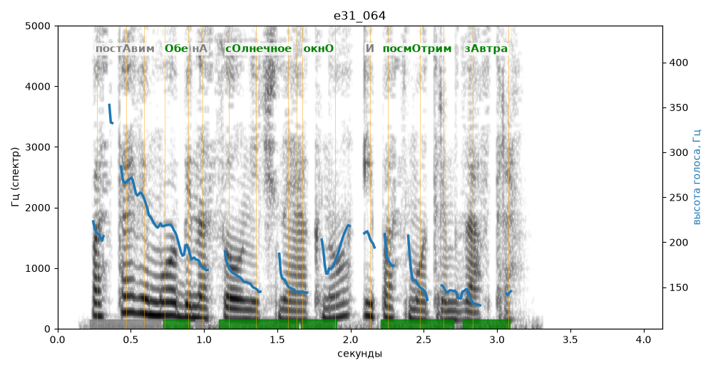

# e31_064

Голос: **edge:ru-RU-SvetlanaNeural** · длительность 4.1 с
Естественность (UTMOS): **3.72 из 5** (живой диктор ≈ 4–4.5)
Эталон: Поставим обе на солнечное окно и посмотрим завтра.
Распознано: Поставим обе на солнечное окно и посмотрим завтра.
Слова: все совпали

## Ударения
(где нужно: ruaccent)

| слово | нужно | у голоса | |
|---|---|---|---|
| поставим | постАвим | поставИм | ? не разобрать |
| обе | Обе | Обе | ✓ |
| солнечное | сОлнечное | сОлнечное | ✓ |
| окно | окнО | окнО | ✓ |
| посмотрим | посмОтрим | посмОтрим | ✓ |
| завтра | зАвтра | зАвтра | ✓ |

## Интонация
- ✓ «поставим обе на солнечное окно и посмотрим завтра.» — конец фразы понижается — звучит законченно
- Диапазон голоса 11.4 полутонов (живо), средняя высота 175 Гц

## Паузы и темп
- паузы на своих местах
- Темп 6.8 слога/с (быстро)

_Синяя линия — высота голоса. Над словами заглавная буква — где ударение должно быть; красным — голос поставил не туда (уверенно), оранжевым — возможно._
