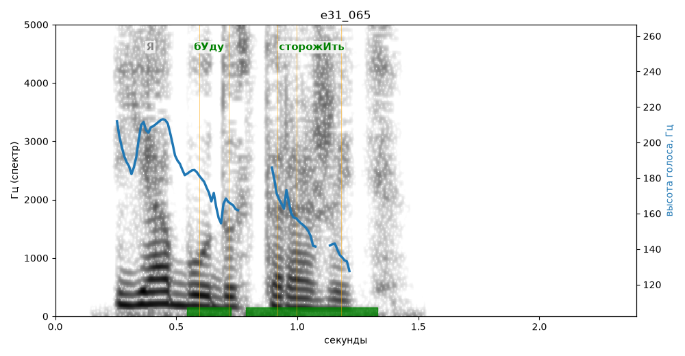

# e31_065

Голос: **edge:ru-RU-SvetlanaNeural** · длительность 2.4 с
Естественность (UTMOS): **3.89 из 5** (живой диктор ≈ 4–4.5)
Эталон: Я буду сторожить.
Распознано: Я буду сторожить.
Слова: все совпали

## Ударения
(где нужно: ruaccent)

| слово | нужно | у голоса | |
|---|---|---|---|
| буду | бУду | бУду | ✓ |
| сторожить | сторожИть | сторожИть | ✓ |

## Интонация
- ✓ «я буду сторожить.» — конец фразы понижается — звучит законченно
- Диапазон голоса 7.6 полутонов (живо), средняя высота 175 Гц

## Паузы и темп
- паузы на своих местах
- Темп 5.3 слога/с (нормально)

_Синяя линия — высота голоса. Над словами заглавная буква — где ударение должно быть; красным — голос поставил не туда (уверенно), оранжевым — возможно._
