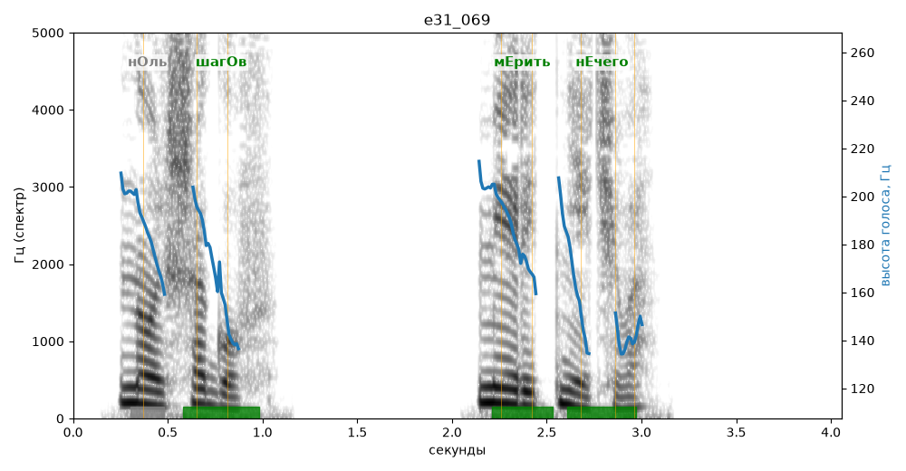

# e31_069

Голос: **edge:ru-RU-SvetlanaNeural** · длительность 4.1 с
Естественность (UTMOS): **3.98 из 5** (живой диктор ≈ 4–4.5)
Эталон: Ноль шагов! Мерить нечего.
Распознано: 0 шагов. Мерить нечего.
Расхождения в словах: «ноль» → «0»

## Ударения
(где нужно: ruaccent)

| слово | нужно | у голоса | |
|---|---|---|---|
| шагов | шагОв | шагОв | ✓ |
| мерить | мЕрить | мЕрить | ✓ |
| нечего | нЕчего | нЕчего | ✓ |

## Интонация
- ✗ «ноль шагов!» — восклицание звучит ровно, без эмоции
- ✗ «мерить нечего.» — конец фразы не понижается — звучит незаконченно / как перечисление
- Диапазон голоса 6.9 полутонов (нормально), средняя высота 178 Гц

## Паузы и темп
- паузы на своих местах
- Темп 5.5 слога/с (нормально)

_Синяя линия — высота голоса. Над словами заглавная буква — где ударение должно быть; красным — голос поставил не туда (уверенно), оранжевым — возможно._
