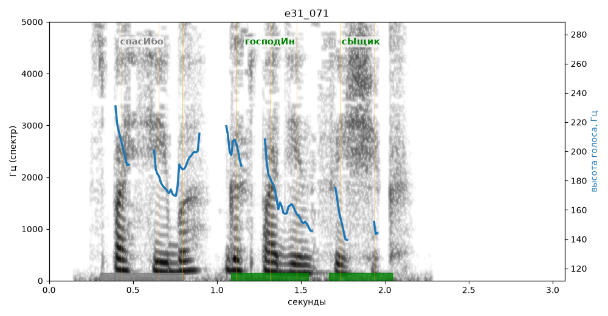

# e31_071

Голос: **edge:ru-RU-SvetlanaNeural** · длительность 3.1 с
Естественность (UTMOS): **4.13 из 5** (живой диктор ≈ 4–4.5)
Эталон: Спасибо, господин сыщик.
Распознано: Спасибо, господин сыщик.
Слова: все совпали

## Ударения
(где нужно: ruaccent)

| слово | нужно | у голоса | |
|---|---|---|---|
| спасибо | спасИбо | спАсибо | ? не разобрать |
| господин | господИн | господИн | ✓ |
| сыщик | сЫщик | сЫщик | ✓ |

## Интонация
- ✓ «спасибо господин сыщик.» — конец фразы понижается — звучит законченно
- Диапазон голоса 6.6 полутонов (нормально), средняя высота 177 Гц

## Паузы и темп
- паузы на своих местах
- Темп 5.5 слога/с (нормально)

_Синяя линия — высота голоса. Над словами заглавная буква — где ударение должно быть; красным — голос поставил не туда (уверенно), оранжевым — возможно._
