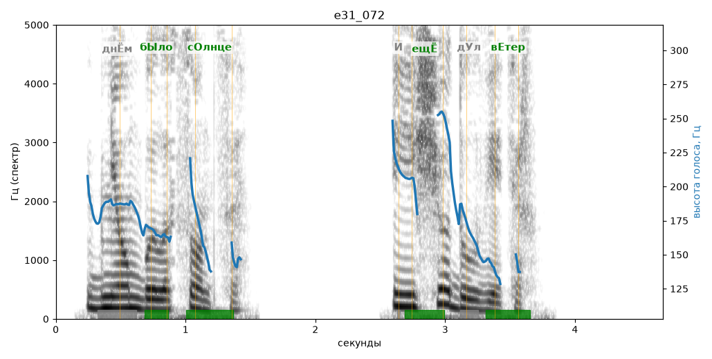

# e31_072

Голос: **edge:ru-RU-SvetlanaNeural** · длительность 4.7 с
Естественность (UTMOS): **3.88 из 5** (живой диктор ≈ 4–4.5)
Эталон: Днём было солнце. И ещё дул ветер.
Распознано: Днем было солнце. И еще дул ветер.
Слова: все совпали

## Ударения
(где нужно: ruaccent)

| слово | нужно | у голоса | |
|---|---|---|---|
| было | бЫло | бЫло | ✓ |
| солнце | сОлнце | сОлнце | ✓ |
| ещё | ещЁ | ещЁ | ✓ |
| ветер | вЕтер | вЕтер | ✓ |

## Интонация
- ✗ «днём было солнце.» — конец фразы не понижается — звучит незаконченно / как перечисление
- ✓ «и ещё дул ветер.» — конец фразы понижается — звучит законченно
- Диапазон голоса 9.6 полутонов (живо), средняя высота 177 Гц

## Паузы и темп
- паузы на своих местах
- Темп 5.3 слога/с (нормально)

_Синяя линия — высота голоса. Над словами заглавная буква — где ударение должно быть; красным — голос поставил не туда (уверенно), оранжевым — возможно._
