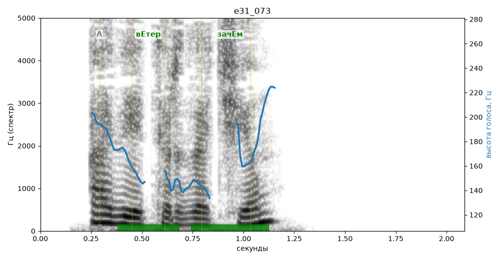

# e31_073

Голос: **edge:ru-RU-SvetlanaNeural** · длительность 2.1 с
Естественность (UTMOS): **3.56 из 5** (живой диктор ≈ 4–4.5)
Эталон: А ветер зачем?
Распознано: А ветер зачем?
Слова: все совпали

## Ударения
(где нужно: ruaccent)

| слово | нужно | у голоса | |
|---|---|---|---|
| ветер | вЕтер | вЕтер | ✓ |
| зачем | зачЕм | зачЕм | ✓ |

## Интонация
- ✓ «а ветер зачем?» — вопросительный подъём на слове «а»
- Диапазон голоса 7.9 полутонов (живо), средняя высота 161 Гц

## Паузы и темп
- паузы на своих местах
- Темп 5.9 слога/с (нормально)

_Синяя линия — высота голоса. Над словами заглавная буква — где ударение должно быть; красным — голос поставил не туда (уверенно), оранжевым — возможно._
