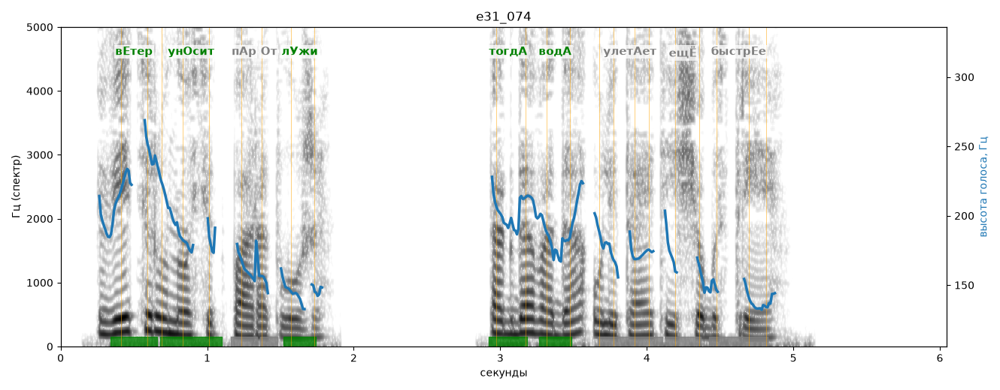

# e31_074

Голос: **edge:ru-RU-SvetlanaNeural** · длительность 6.0 с
Естественность (UTMOS): **3.61 из 5** (живой диктор ≈ 4–4.5)
Эталон: Ветер уносит пар от лужи. Тогда вода улетает ещё быстрее.
Распознано: Ветер уносит пара тлужи. Тогда вода улетает еще быстрее.
Расхождения в словах: «пар от лужи» → «пара тлужи»

## Ударения
(где нужно: ruaccent)

| слово | нужно | у голоса | |
|---|---|---|---|
| ветер | вЕтер | вЕтер | ✓ |
| уносит | унОсит | унОсит | ✓ |
| лужи | лУжи | лУжи | ✓ |
| тогда | тогдА | тогдА | ✓ |
| вода | водА | водА | ✓ |
| улетает | улетАет | Улетает | ? не разобрать |
| ещё | ещЁ | Ещё | ? не разобрать |
| быстрее | быстрЕе | быстреЕ | ? не разобрать |

## Интонация
- ✓ «ветер уносит пар от лужи.» — конец фразы понижается — звучит законченно
- ✓ «тогда вода улетает ещё быстрее.» — конец фразы понижается — звучит законченно
- Диапазон голоса 9.1 полутонов (живо), средняя высота 180 Гц

## Паузы и темп
- паузы на своих местах
- Темп 7.0 слога/с (быстро)

_Синяя линия — высота голоса. Над словами заглавная буква — где ударение должно быть; красным — голос поставил не туда (уверенно), оранжевым — возможно._
