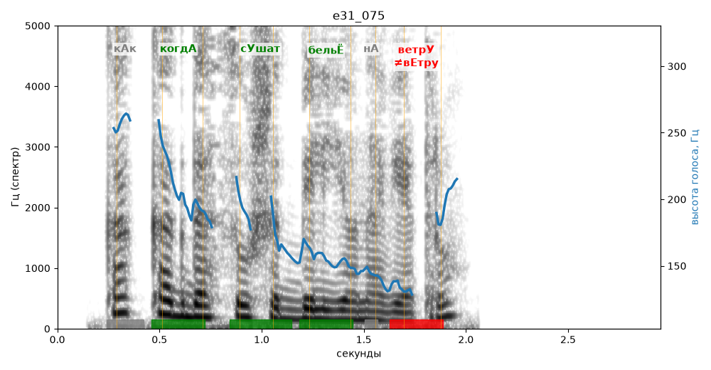

# e31_075

Голос: **edge:ru-RU-SvetlanaNeural** · длительность 3.0 с
Естественность (UTMOS): **3.73 из 5** (живой диктор ≈ 4–4.5)
Эталон: Как когда сушат бельё на ветру?
Распознано: Как, когда сушит бельё на ветру?
Расхождения в словах: «сушат» → «сушит»

## Ударения
(где нужно: ruaccent)

| слово | нужно | у голоса | |
|---|---|---|---|
| когда | когдА | когдА | ✓ |
| сушат | сУшат | сУшат | ✓ |
| бельё | бельЁ | бельЁ | ✓ |
| ветру | ветрУ | вЕтру | ✗ ОШИБКА |

## Интонация
- ✗ «как когда сушат бельё на ветру?» — конец фразы не понижается — звучит незаконченно / как перечисление
- Диапазон голоса 11.4 полутонов (живо), средняя высота 165 Гц

## Паузы и темп
- паузы на своих местах
- Темп 6.1 слога/с (нормально)

_Синяя линия — высота голоса. Над словами заглавная буква — где ударение должно быть; красным — голос поставил не туда (уверенно), оранжевым — возможно._
