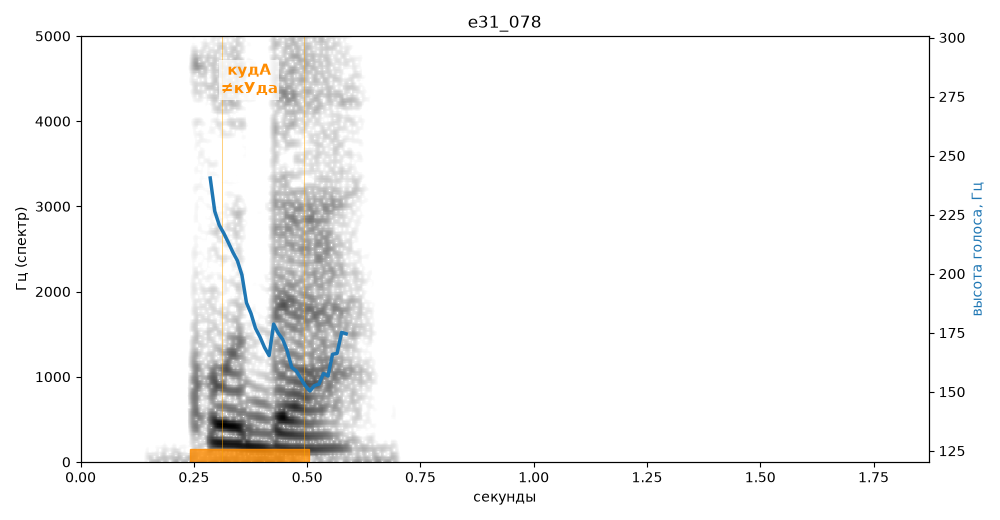

# e31_078

Голос: **edge:ru-RU-SvetlanaNeural** · длительность 1.9 с
Естественность (UTMOS): **3.67 из 5** (живой диктор ≈ 4–4.5)
Эталон: Куда?
Распознано: Куда?
Слова: все совпали

## Ударения
(где нужно: ruaccent)

| слово | нужно | у голоса | |
|---|---|---|---|
| куда | кудА | кУда | ✗? возможно — послушать |

## Интонация
- Диапазон голоса 6.6 полутонов (нормально), средняя высота 173 Гц

## Паузы и темп
- паузы на своих местах
- Темп 7.6 слога/с (быстро)

_Синяя линия — высота голоса. Над словами заглавная буква — где ударение должно быть; красным — голос поставил не туда (уверенно), оранжевым — возможно._
