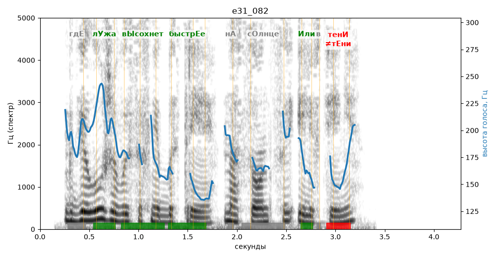

# e31_082

Голос: **edge:ru-RU-SvetlanaNeural** · длительность 4.3 с
Естественность (UTMOS): **3.63 из 5** (живой диктор ≈ 4–4.5)
Эталон: Где лужа высохнет быстрее: на солнце или в тени?
Распознано: где лужа высохнет быстрее на солнце или в тени?
Слова: все совпали

## Ударения
(где нужно: ruaccent)

| слово | нужно | у голоса | |
|---|---|---|---|
| лужа | лУжа | лУжа | ✓ |
| высохнет | вЫсохнет | вЫсохнет | ✓ |
| быстрее | быстрЕе | быстрЕе | ✓ |
| солнце | сОлнце | солнцЕ | ? не разобрать |
| или | Или | Или | ✓ |
| тени | тенИ | тЕни | ✗ ОШИБКА |

## Интонация
- ✗ «где лужа высохнет быстрее на солнце или в тени?» — конец фразы не понижается — звучит незаконченно / как перечисление
- Диапазон голоса 8.0 полутонов (живо), средняя высота 175 Гц

## Паузы и темп
- паузы на своих местах
- Темп 6.8 слога/с (быстро)

_Синяя линия — высота голоса. Над словами заглавная буква — где ударение должно быть; красным — голос поставил не туда (уверенно), оранжевым — возможно._
