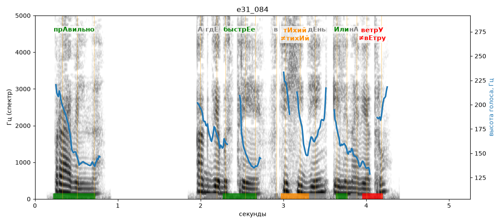

# e31_084

Голос: **edge:ru-RU-SvetlanaNeural** · длительность 5.3 с
Естественность (UTMOS): **3.63 из 5** (живой диктор ≈ 4–4.5)
Эталон: Правильно! А где быстрее: в тихий день или на ветру?
Распознано: Правильно. А где быстрее? В тихий день или на ветру?
Слова: все совпали

## Ударения
(где нужно: ruaccent)

| слово | нужно | у голоса | |
|---|---|---|---|
| правильно | прАвильно | прАвильно | ✓ |
| быстрее | быстрЕе | быстрЕе | ✓ |
| тихий | тИхий | тихИй | ✗? возможно — послушать |
| или | Или | Или | ✓ |
| ветру | ветрУ | вЕтру | ✗ ОШИБКА |

## Интонация
- ✓ «правильно!» — выделено слово «правильно» (+5.5 пт)
- ✓ «а где быстрее в тихий день или на ветру?» — вопросительный подъём на слове «тихий»
- Диапазон голоса 7.7 полутонов (живо), средняя высота 160 Гц

## Паузы и темп
- паузы на своих местах
- Темп 6.8 слога/с (быстро)

_Синяя линия — высота голоса. Над словами заглавная буква — где ударение должно быть; красным — голос поставил не туда (уверенно), оранжевым — возможно._
