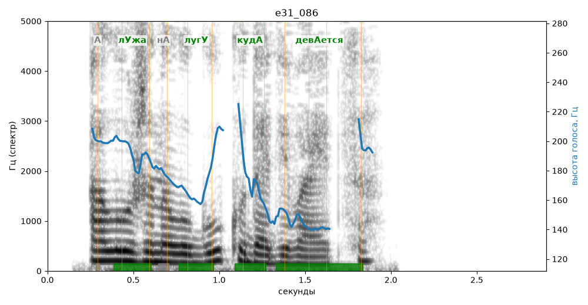

# e31_086

Голос: **edge:ru-RU-SvetlanaNeural** · длительность 2.9 с
Естественность (UTMOS): **4.01 из 5** (живой диктор ≈ 4–4.5)
Эталон: А лужа на лугу куда девается?
Распознано: А лужа на лугу куда девается?
Слова: все совпали

## Ударения
(где нужно: ruaccent)

| слово | нужно | у голоса | |
|---|---|---|---|
| лужа | лУжа | лУжа | ✓ |
| лугу | лугУ | лугУ | ✓ |
| куда | кудА | кудА | ✓ |
| девается | девАется | девАется | ✓ |

## Интонация
- ✗ «а лужа на лугу куда девается?» — нет вопросительного подъёма (самое высокое место — «лужа», в начале) — звучит как утверждение
- Диапазон голоса 6.8 полутонов (нормально), средняя высота 175 Гц

## Паузы и темп
- паузы на своих местах
- Темп 7.7 слога/с (быстро)

_Синяя линия — высота голоса. Над словами заглавная буква — где ударение должно быть; красным — голос поставил не туда (уверенно), оранжевым — возможно._
