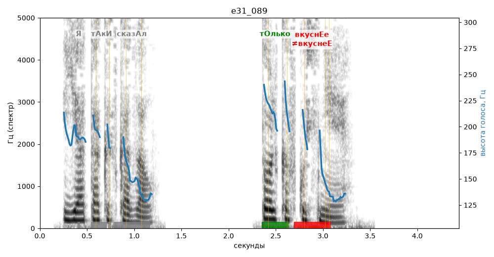

# e31_089

Голос: **edge:ru-RU-SvetlanaNeural** · длительность 4.4 с
Естественность (UTMOS): **4.02 из 5** (живой диктор ≈ 4–4.5)
Эталон: Я так и сказал. Только вкуснее.
Распознано: Я так и сказал. Только вкуснее.
Слова: все совпали

## Ударения
(где нужно: ruaccent)

| слово | нужно | у голоса | |
|---|---|---|---|
| сказал | сказАл | скАзал | ? не разобрать |
| только | тОлько | тОлько | ✓ |
| вкуснее | вкуснЕе | вкуснеЕ | ✗ ОШИБКА |

## Интонация
- ✓ «я так и сказал.» — конец фразы понижается — звучит законченно
- ✓ «только вкуснее.» — конец фразы понижается — звучит законченно
- Диапазон голоса 9.4 полутонов (живо), средняя высота 182 Гц

## Паузы и темп
- паузы на своих местах
- Темп 6.1 слога/с (нормально)

_Синяя линия — высота голоса. Над словами заглавная буква — где ударение должно быть; красным — голос поставил не туда (уверенно), оранжевым — возможно._
