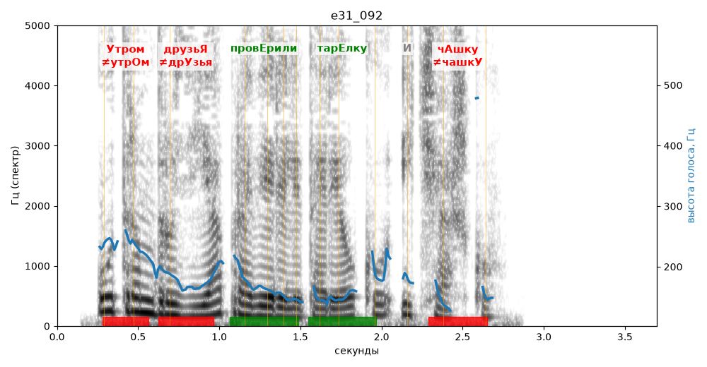

# e31_092

Голос: **edge:ru-RU-SvetlanaNeural** · длительность 3.7 с
Естественность (UTMOS): **3.51 из 5** (живой диктор ≈ 4–4.5)
Эталон: Утром друзья проверили тарелку и чашку.
Распознано: Утром, друзья, проверили тарелку и чашку.
Слова: все совпали

## Ударения
(где нужно: ruaccent)

| слово | нужно | у голоса | |
|---|---|---|---|
| утром | Утром | утрОм | ✗ ОШИБКА |
| друзья | друзьЯ | дрУзья | ✗ ОШИБКА |
| проверили | провЕрили | провЕрили | ✓ |
| тарелку | тарЕлку | тарЕлку | ✓ |
| чашку | чАшку | чашкУ | ✗ ОШИБКА |

## Интонация
- ✓ «утром друзья проверили тарелку и чашку.» — конец фразы понижается — звучит законченно
- Диапазон голоса 9.2 полутонов (живо), средняя высота 170 Гц

## Паузы и темп
- паузы на своих местах
- Темп 5.9 слога/с (нормально)

_Синяя линия — высота голоса. Над словами заглавная буква — где ударение должно быть; красным — голос поставил не туда (уверенно), оранжевым — возможно._
