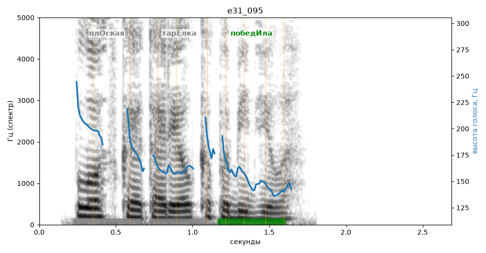

# e31_095

Голос: **edge:ru-RU-SvetlanaNeural** · длительность 2.7 с
Естественность (UTMOS): **3.91 из 5** (живой диктор ≈ 4–4.5)
Эталон: Плоская тарелка победила!
Распознано: Плоская тарелка победила.
Слова: все совпали

## Ударения
(где нужно: ruaccent)

| слово | нужно | у голоса | |
|---|---|---|---|
| плоская | плОская | — | ? |
| тарелка | тарЕлка | тАрелка | ? не разобрать |
| победила | победИла | победИла | ✓ |

## Интонация
- ✓ «плоская тарелка победила!» — выделено слово «плоская» (+3.6 пт)
- Диапазон голоса 6.9 полутонов (нормально), средняя высота 161 Гц

## Паузы и темп
- паузы на своих местах
- Темп 6.5 слога/с (нормально)

_Синяя линия — высота голоса. Над словами заглавная буква — где ударение должно быть; красным — голос поставил не туда (уверенно), оранжевым — возможно._
