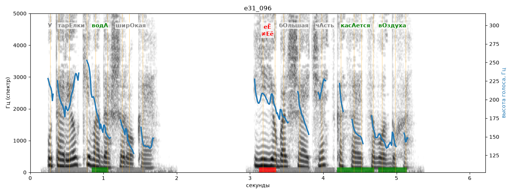

# e31_096

Голос: **edge:ru-RU-SvetlanaNeural** · длительность 6.2 с
Естественность (UTMOS): **3.99 из 5** (живой диктор ≈ 4–4.5)
Эталон: У тарелки вода широкая. Её большая часть касается воздуха.
Распознано: У тарелки вода широкая. Ее большая часть касается воздуха.
Слова: все совпали

## Ударения
(где нужно: ruaccent)

| слово | нужно | у голоса | |
|---|---|---|---|
| тарелки | тарЕлки | тАрелки | ? не разобрать |
| вода | водА | водА | ✓ |
| широкая | ширОкая | — | ? |
| её | еЁ | Её | ✗ ОШИБКА |
| большая | бОльшая | — | ? |
| касается | касАется | касАется | ✓ |
| воздуха | вОздуха | вОздуха | ✓ |

## Интонация
- ✓ «у тарелки вода широкая.» — конец фразы понижается — звучит законченно
- ✓ «её большая часть касается воздуха.» — конец фразы понижается — звучит законченно
- Диапазон голоса 8.8 полутонов (живо), средняя высота 175 Гц

## Паузы и темп
- паузы на своих местах
- Темп 6.3 слога/с (нормально)

_Синяя линия — высота голоса. Над словами заглавная буква — где ударение должно быть; красным — голос поставил не туда (уверенно), оранжевым — возможно._
