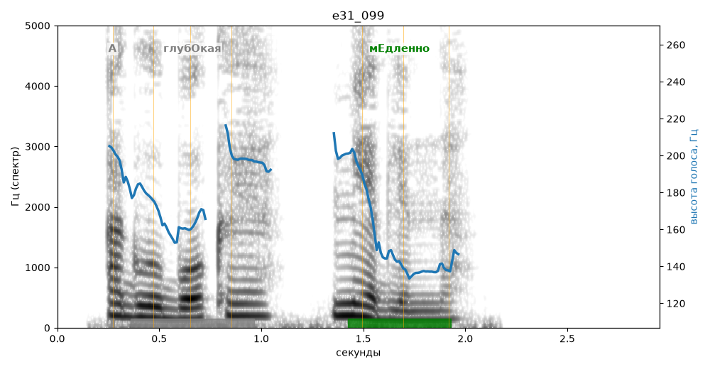

# e31_099

Голос: **edge:ru-RU-SvetlanaNeural** · длительность 3.0 с
Естественность (UTMOS): **3.98 из 5** (живой диктор ≈ 4–4.5)
Эталон: А глубокая — медленно.
Распознано: А глубокое — медленно.
Расхождения в словах: «глубокая» → «глубокое»

## Ударения
(где нужно: ruaccent)

| слово | нужно | у голоса | |
|---|---|---|---|
| глубокая | глубОкая | — | ? |
| медленно | мЕдленно | мЕдленно | ✓ |

## Интонация
- ✗ «а глубокая медленно.» — конец фразы не понижается — звучит незаконченно / как перечисление
- Диапазон голоса 6.8 полутонов (нормально), средняя высота 171 Гц

## Паузы и темп
- паузы на своих местах
- Темп 5.8 слога/с (нормально)

_Синяя линия — высота голоса. Над словами заглавная буква — где ударение должно быть; красным — голос поставил не туда (уверенно), оранжевым — возможно._
