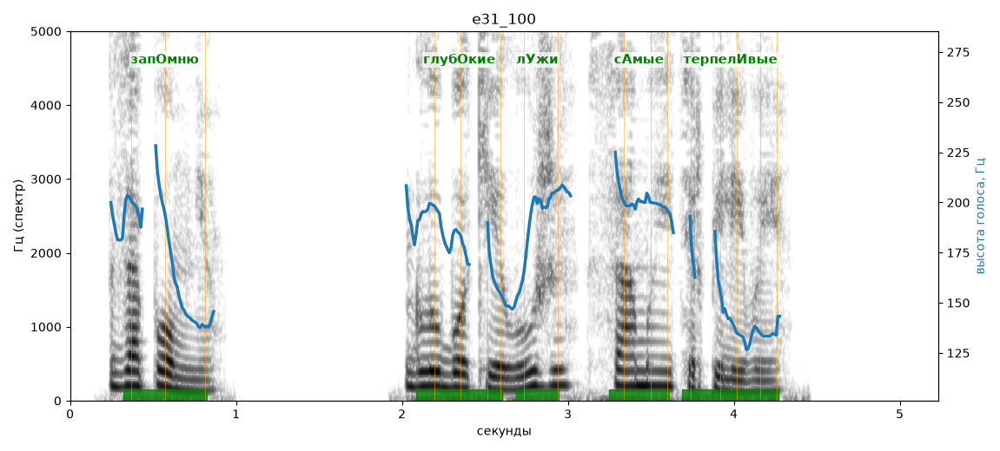

# e31_100

Голос: **edge:ru-RU-SvetlanaNeural** · длительность 5.2 с
Естественность (UTMOS): **3.5 из 5** (живой диктор ≈ 4–4.5)
Эталон: Запомню. Глубокие лужи — самые терпеливые.
Распознано: Запомню. Глубокие лужи, самые терпеливые.
Слова: все совпали

## Ударения
(где нужно: ruaccent)

| слово | нужно | у голоса | |
|---|---|---|---|
| запомню | запОмню | запОмню | ✓ |
| глубокие | глубОкие | глубОкие | ✓ |
| лужи | лУжи | лУжи | ✓ |
| самые | сАмые | сАмые | ✓ |
| терпеливые | терпелИвые | терпелИвые | ✓ |

## Интонация
- ✗ «запомню.» — конец фразы не понижается — звучит незаконченно / как перечисление
- ✓ «глубокие лужи самые терпеливые.» — конец фразы понижается — звучит законченно
- Диапазон голоса 7.5 полутонов (живо), средняя высота 184 Гц

## Паузы и темп
- паузы на своих местах
- Темп 7.1 слога/с (быстро)

_Синяя линия — высота голоса. Над словами заглавная буква — где ударение должно быть; красным — голос поставил не туда (уверенно), оранжевым — возможно._
