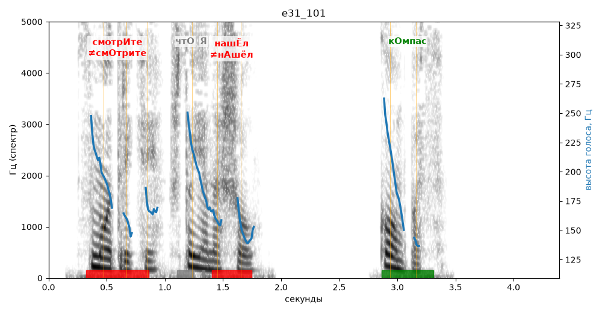

# e31_101

Голос: **edge:ru-RU-SvetlanaNeural** · длительность 4.4 с
Естественность (UTMOS): **3.8 из 5** (живой диктор ≈ 4–4.5)
Эталон: Смотрите, что я нашёл! Компас!
Распознано: Смотрите, что я нашел. Компас.
Слова: все совпали

## Ударения
(где нужно: ruaccent)

| слово | нужно | у голоса | |
|---|---|---|---|
| смотрите | смотрИте | смОтрите | ✗ ОШИБКА |
| нашёл | нашЁл | нАшёл | ✗ ОШИБКА |
| компас | кОмпас | кОмпас | ✓ |

## Интонация
- ✓ «смотрите что я нашёл!» — выделено слово «что» (+3.9 пт)
- Диапазон голоса 9.1 полутонов (живо), средняя высота 170 Гц

## Паузы и темп
- паузы на своих местах
- Темп 4.9 слога/с (нормально)

_Синяя линия — высота голоса. Над словами заглавная буква — где ударение должно быть; красным — голос поставил не туда (уверенно), оранжевым — возможно._
