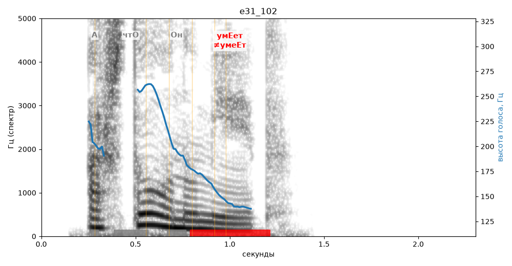

# e31_102

Голос: **edge:ru-RU-SvetlanaNeural** · длительность 2.3 с
Естественность (UTMOS): **3.98 из 5** (живой диктор ≈ 4–4.5)
Эталон: А что он умеет?
Распознано: А что он умеет?
Слова: все совпали

## Ударения
(где нужно: ruaccent)

| слово | нужно | у голоса | |
|---|---|---|---|
| умеет | умЕет | умеЕт | ✗ ОШИБКА |

## Интонация
- ✓ «а что он умеет?» — вопросительный подъём на слове «что»
- Диапазон голоса 10.9 полутонов (живо), средняя высота 184 Гц

## Паузы и темп
- паузы на своих местах
- Темп 6.3 слога/с (нормально)

_Синяя линия — высота голоса. Над словами заглавная буква — где ударение должно быть; красным — голос поставил не туда (уверенно), оранжевым — возможно._
