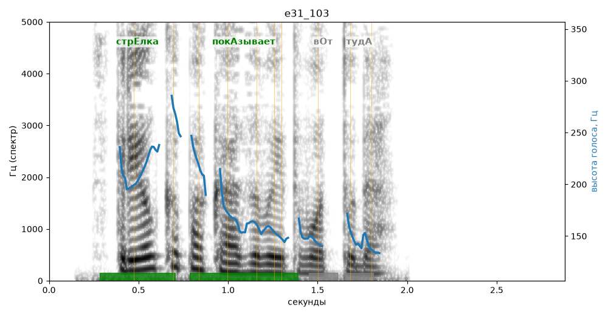

# e31_103

Голос: **edge:ru-RU-SvetlanaNeural** · длительность 2.9 с
Естественность (UTMOS): **3.98 из 5** (живой диктор ≈ 4–4.5)
Эталон: Стрелка показывает вот туда.
Распознано: Стрелка показывает вот туда.
Слова: все совпали

## Ударения
(где нужно: ruaccent)

| слово | нужно | у голоса | |
|---|---|---|---|
| стрелка | стрЕлка | стрЕлка | ✓ |
| показывает | покАзывает | покАзывает | ✓ |
| туда | тудА | тУда | ? не разобрать |

## Интонация
- ✓ «стрелка показывает вот туда.» — конец фразы понижается — звучит законченно
- Диапазон голоса 10.1 полутонов (живо), средняя высота 162 Гц

## Паузы и темп
- паузы на своих местах
- Темп 6.5 слога/с (нормально)

_Синяя линия — высота голоса. Над словами заглавная буква — где ударение должно быть; красным — голос поставил не туда (уверенно), оранжевым — возможно._
