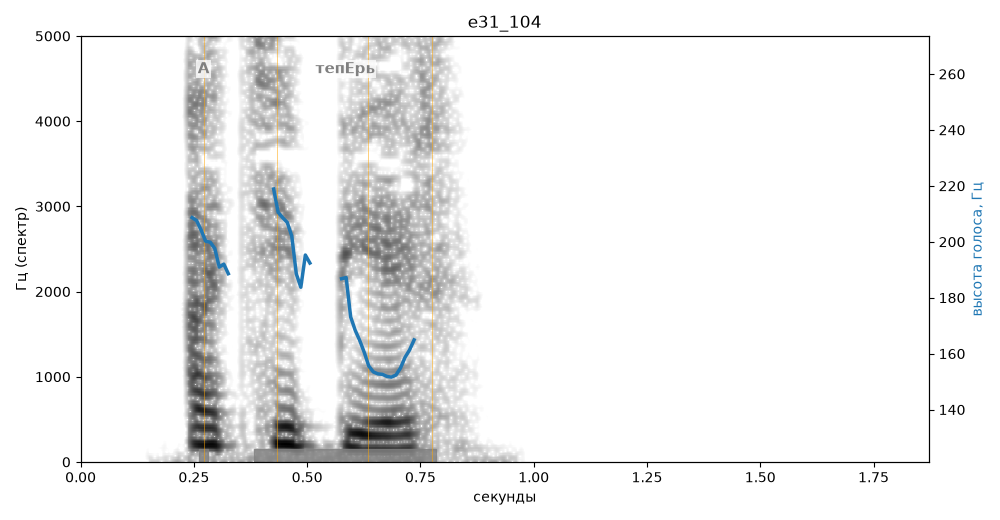

# e31_104

Голос: **edge:ru-RU-SvetlanaNeural** · длительность 1.9 с
Естественность (UTMOS): **3.87 из 5** (живой диктор ≈ 4–4.5)
Эталон: А теперь?
Распознано: А теперь...
Слова: все совпали

## Ударения
(где нужно: ruaccent)

| слово | нужно | у голоса | |
|---|---|---|---|
| теперь | тепЕрь | — | ? |

## Интонация
- ✗ «а теперь?» — нет вопросительного подъёма (самое высокое место — «а», в начале) — звучит как утверждение
- Диапазон голоса 5.5 полутонов (нормально), средняя высота 187 Гц

## Паузы и темп
- паузы на своих местах
- Темп 7.6 слога/с (быстро)

_Синяя линия — высота голоса. Над словами заглавная буква — где ударение должно быть; красным — голос поставил не туда (уверенно), оранжевым — возможно._
