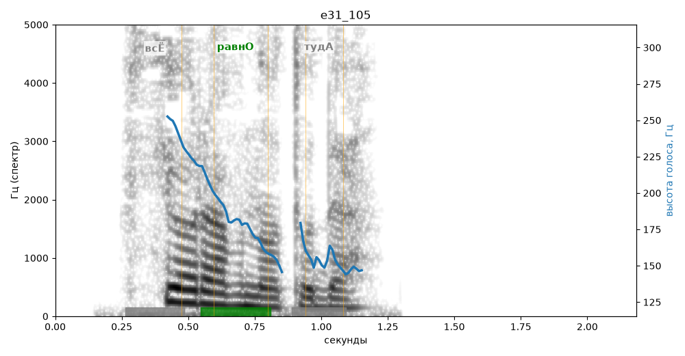

# e31_105

Голос: **edge:ru-RU-SvetlanaNeural** · длительность 2.2 с
Естественность (UTMOS): **3.71 из 5** (живой диктор ≈ 4–4.5)
Эталон: Всё равно туда!
Распознано: Всё равно туда.
Слова: все совпали

## Ударения
(где нужно: ruaccent)

| слово | нужно | у голоса | |
|---|---|---|---|
| равно | равнО | равнО | ✓ |
| туда | тудА | тУда | ? не разобрать |

## Интонация
- ✓ «всё равно туда!» — выделено слово «всё» (+6.2 пт)
- Диапазон голоса 8.9 полутонов (живо), средняя высота 171 Гц

## Паузы и темп
- паузы на своих местах
- Темп 6.0 слога/с (нормально)

_Синяя линия — высота голоса. Над словами заглавная буква — где ударение должно быть; красным — голос поставил не туда (уверенно), оранжевым — возможно._
