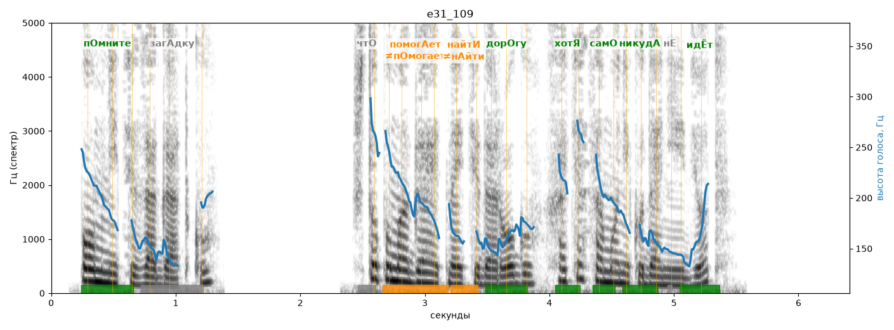

# e31_109

Голос: **edge:ru-RU-SvetlanaNeural** · длительность 6.4 с
Естественность (UTMOS): **3.76 из 5** (живой диктор ≈ 4–4.5)
Эталон: Помните загадку? Что помогает найти дорогу, хотя само никуда не идёт?
Распознано: Помните загадку? Что помогает найти дорогу, хотя само никуда не идёт?
Слова: все совпали

## Ударения
(где нужно: ruaccent)

| слово | нужно | у голоса | |
|---|---|---|---|
| помните | пОмните | пОмните | ✓ |
| загадку | загАдку | зАгадку | ? не разобрать |
| помогает | помогАет | пОмогает | ✗? возможно — послушать |
| найти | найтИ | нАйти | ✗? возможно — послушать |
| дорогу | дорОгу | дорОгу | ✓ |
| хотя | хотЯ | хотЯ | ✓ |
| само | самО | самО | ✓ |
| никуда | никудА | никудА | ✓ |
| идёт | идЁт | идЁт | ✓ |

## Интонация
- ✗ «помните загадку?» — нет вопросительного подъёма (самое высокое место — «помните», в начале) — звучит как утверждение
- ✓ «что помогает найти дорогу хотя само никуда не идёт?» — конец фразы понижается — звучит законченно
- Диапазон голоса 9.8 полутонов (живо), средняя высота 172 Гц

## Паузы и темп
- паузы на своих местах
- Темп 7.1 слога/с (быстро)

_Синяя линия — высота голоса. Над словами заглавная буква — где ударение должно быть; красным — голос поставил не туда (уверенно), оранжевым — возможно._
