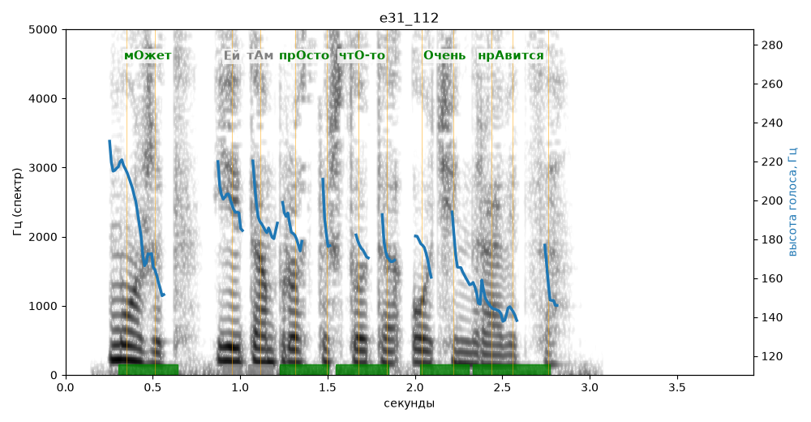

# e31_112

Голос: **edge:ru-RU-SvetlanaNeural** · длительность 3.9 с
Естественность (UTMOS): **3.63 из 5** (живой диктор ≈ 4–4.5)
Эталон: Может, ей там просто что-то очень нравится?
Распознано: Может, ей там просто что-то очень нравится.
Слова: все совпали

## Ударения
(где нужно: ruaccent)

| слово | нужно | у голоса | |
|---|---|---|---|
| может | мОжет | мОжет | ✓ |
| просто | прОсто | прОсто | ✓ |
| что-то | чтО-то | чтО-то | ✓ |
| очень | Очень | Очень | ✓ |
| нравится | нрАвится | нрАвится | ✓ |

## Интонация
- ✗ «может ей там просто что-то очень нравится?» — нет вопросительного подъёма (самое высокое место — «может», в начале) — звучит как утверждение
- Диапазон голоса 7.2 полутонов (живо), средняя высота 177 Гц

## Паузы и темп
- паузы на своих местах
- Темп 6.4 слога/с (нормально)

_Синяя линия — высота голоса. Над словами заглавная буква — где ударение должно быть; красным — голос поставил не туда (уверенно), оранжевым — возможно._
