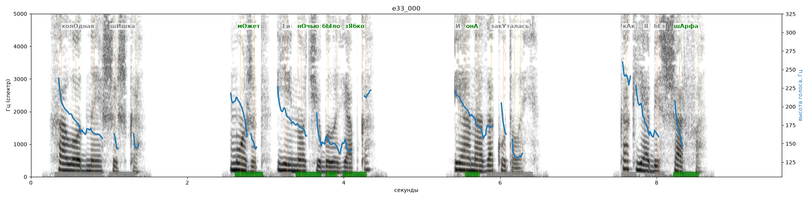

# e33_000

Голос: **edge:ru-RU-SvetlanaNeural** · длительность 9.6 с
Естественность (UTMOS): **3.85 из 5** (живой диктор ≈ 4–4.5)
Эталон: Холодная шишка! Может, ей ночью было зябко? И она закуталась. Как я без шарфа.
Распознано: Холодная шишка. Может, ей ночью была зябка? И она закуталась. Как я без шарфа.
Расхождения в словах: «было зябко» → «была зябка»

## Ударения
(где нужно: ruaccent)

| слово | нужно | у голоса | |
|---|---|---|---|
| холодная | холОдная | — | ? |
| шишка | шИшка | шишкА | ? не разобрать |
| может | мОжет | мОжет | ✓ |
| ночью | нОчью | нОчью | ✓ |
| было | бЫло | бЫло | ✓ |
| зябко | зЯбко | зЯбко | ✓ |
| она | онА | онА | ✓ |
| закуталась | закУталась | зАкуталась | ? не разобрать |
| шарфа | шАрфа | шАрфа | ✓ |

## Интонация
- ✗ «холодная шишка!» — восклицание звучит ровно, без эмоции
- ✗ «может ей ночью было зябко?» — нет вопросительного подъёма (самое высокое место — «может», в начале) — звучит как утверждение
- ✗ «и она закуталась.» — конец фразы не понижается — звучит незаконченно / как перечисление
- ✗ «как я без шарфа.» — конец фразы не понижается — звучит незаконченно / как перечисление
- Диапазон голоса 8.0 полутонов (живо), средняя высота 172 Гц

## Паузы и темп
- паузы на своих местах
- Темп 5.4 слога/с (нормально)

_Синяя линия — высота голоса. Над словами заглавная буква — где ударение должно быть; красным — голос поставил не туда (уверенно), оранжевым — возможно._
