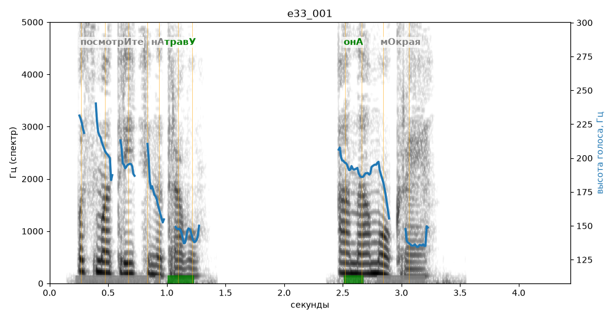

# e33_001

Голос: **edge:ru-RU-SvetlanaNeural** · длительность 4.4 с
Естественность (UTMOS): **3.83 из 5** (живой диктор ≈ 4–4.5)
Эталон: Посмотрите на траву. Она мокрая.
Распознано: Посмотрите на траву. Она мокрая.
Слова: все совпали

## Ударения
(где нужно: ruaccent)

| слово | нужно | у голоса | |
|---|---|---|---|
| посмотрите | посмотрИте | пОсмотрите | ? не разобрать |
| траву | травУ | травУ | ✓ |
| она | онА | онА | ✓ |
| мокрая | мОкрая | — | ? |

## Интонация
- ✓ «посмотрите на траву.» — конец фразы понижается — звучит законченно
- ✗ «она мокрая.» — конец фразы не понижается — звучит незаконченно / как перечисление
- Диапазон голоса 8.3 полутонов (живо), средняя высота 187 Гц

## Паузы и темп
- паузы на своих местах
- Темп 6.5 слога/с (нормально)

_Синяя линия — высота голоса. Над словами заглавная буква — где ударение должно быть; красным — голос поставил не туда (уверенно), оранжевым — возможно._
