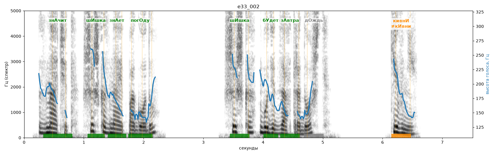

# e33_002

Голос: **edge:ru-RU-SvetlanaNeural** · длительность 7.5 с
Естественность (UTMOS): **3.96 из 5** (живой диктор ≈ 4–4.5)
Эталон: Значит, шишка знает погоду? Шишка, будет завтра дождь? Кивни!
Распознано: Значит, шишка знает погоду? Шишка будет завтра дождь? Кивни.
Слова: все совпали

## Ударения
(где нужно: ruaccent)

| слово | нужно | у голоса | |
|---|---|---|---|
| значит | знАчит | знАчит | ✓ |
| шишка | шИшка | шИшка | ✓ |
| знает | знАет | знАет | ✓ |
| погоду | погОду | погОду | ✓ |
| шишка | шИшка | шИшка | ✓ |
| будет | бУдет | бУдет | ✓ |
| завтра | зАвтра | зАвтра | ✓ |
| кивни | кивнИ | кИвни | ✗? возможно — послушать |

## Интонация
- ✓ «значит шишка знает погоду?» — вопросительный подъём на слове «шишка»
- ✗ «шишка будет завтра дождь?» — нет вопросительного подъёма (самое высокое место — «шишка», в начале) — звучит как утверждение
- Диапазон голоса 8.4 полутонов (живо), средняя высота 175 Гц

## Паузы и темп
- паузы на своих местах
- Темп 5.6 слога/с (нормально)

_Синяя линия — высота голоса. Над словами заглавная буква — где ударение должно быть; красным — голос поставил не туда (уверенно), оранжевым — возможно._
