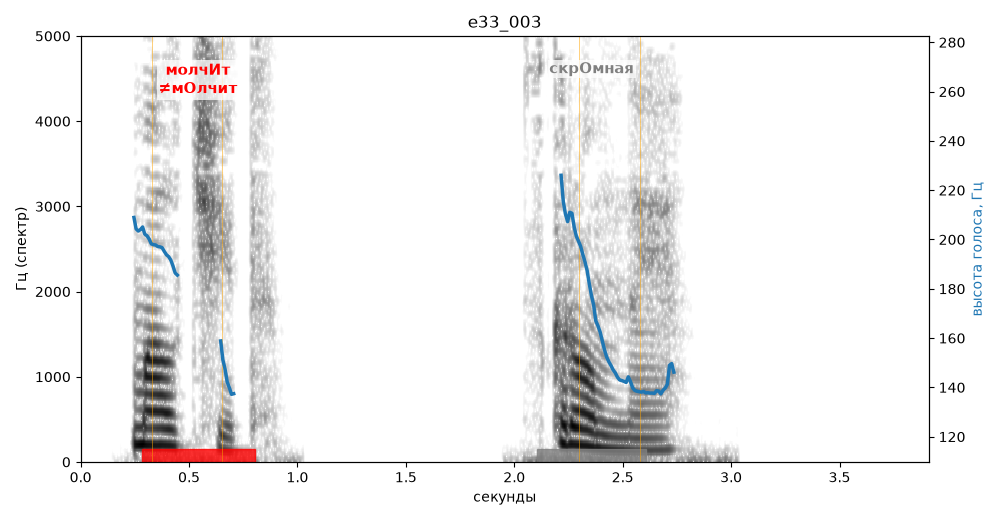

# e33_003

Голос: **edge:ru-RU-SvetlanaNeural** · длительность 3.9 с
Естественность (UTMOS): **4.0 из 5** (живой диктор ≈ 4–4.5)
Эталон: Молчит. Скромная.
Распознано: Молчит. Скромные.
Расхождения в словах: «скромная» → «скромные»

## Ударения
(где нужно: ruaccent)

| слово | нужно | у голоса | |
|---|---|---|---|
| молчит | молчИт | мОлчит | ✗ ОШИБКА |
| скромная | скрОмная | — | ? |

## Интонация
- Диапазон голоса 7.3 полутонов (живо), средняя высота 159 Гц

## Паузы и темп
- паузы на своих местах
- Темп 3.9 слога/с (медленно)

_Синяя линия — высота голоса. Над словами заглавная буква — где ударение должно быть; красным — голос поставил не туда (уверенно), оранжевым — возможно._
