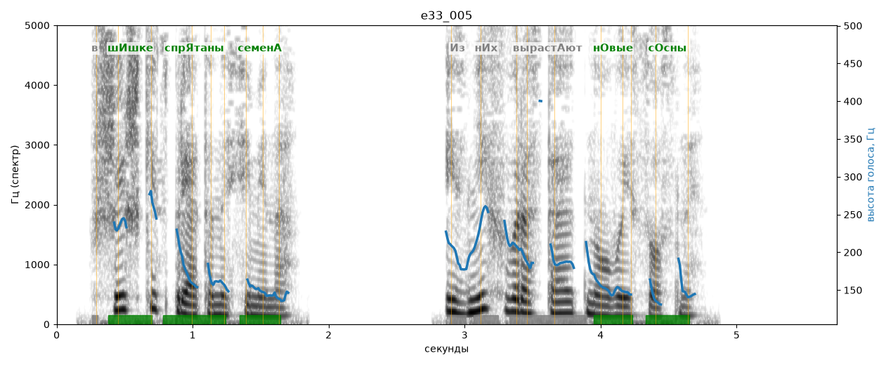

# e33_005

Голос: **edge:ru-RU-SvetlanaNeural** · длительность 5.7 с
Естественность (UTMOS): **3.82 из 5** (живой диктор ≈ 4–4.5)
Эталон: В шишке спрятаны семена. Из них вырастают новые сосны.
Распознано: Шишки спрятаны семена. Из них вырастают новые сосны.
Расхождения в словах: «в шишке» → «шишки»

## Ударения
(где нужно: ruaccent)

| слово | нужно | у голоса | |
|---|---|---|---|
| шишке | шИшке | шИшке | ✓ |
| спрятаны | спрЯтаны | спрЯтаны | ✓ |
| семена | семенА | семенА | ✓ |
| вырастают | вырастАют | — | ? |
| новые | нОвые | нОвые | ✓ |
| сосны | сОсны | сОсны | ✓ |

## Интонация
- ✓ «в шишке спрятаны семена.» — конец фразы понижается — звучит законченно
- ✓ «из них вырастают новые сосны.» — конец фразы понижается — звучит законченно
- Диапазон голоса 10.3 полутонов (живо), средняя высота 175 Гц

## Паузы и темп
- паузы на своих местах
- Темп 6.0 слога/с (нормально)

_Синяя линия — высота голоса. Над словами заглавная буква — где ударение должно быть; красным — голос поставил не туда (уверенно), оранжевым — возможно._
