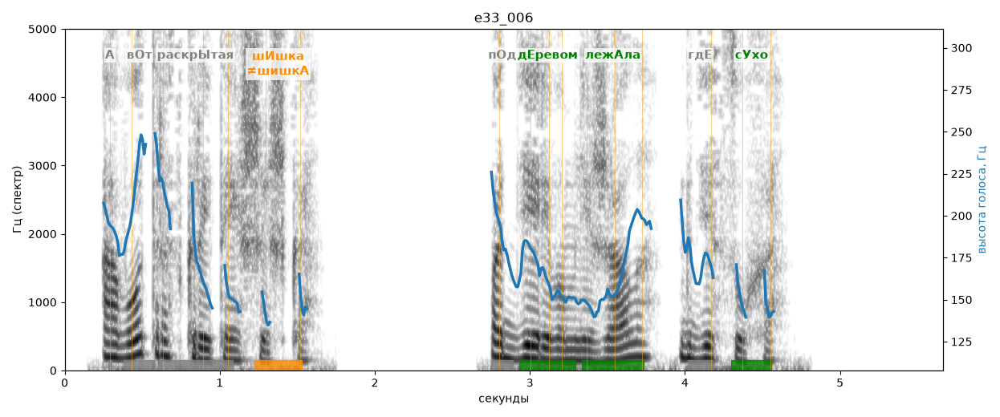

# e33_006

Голос: **edge:ru-RU-SvetlanaNeural** · длительность 5.7 с
Естественность (UTMOS): **3.68 из 5** (живой диктор ≈ 4–4.5)
Эталон: А вот раскрытая шишка. Под деревом лежала, где сухо.
Распознано: А вот раскрытая шишка. Под деревом лежала, где сухо.
Слова: все совпали

## Ударения
(где нужно: ruaccent)

| слово | нужно | у голоса | |
|---|---|---|---|
| раскрытая | раскрЫтая | — | ? |
| шишка | шИшка | шишкА | ✗? возможно — послушать |
| деревом | дЕревом | дЕревом | ✓ |
| лежала | лежАла | лежАла | ✓ |
| сухо | сУхо | сУхо | ✓ |

## Интонация
- ✓ «а вот раскрытая шишка.» — конец фразы понижается — звучит законченно
- ✓ «под деревом лежала где сухо.» — конец фразы понижается — звучит законченно
- Диапазон голоса 7.8 полутонов (живо), средняя высота 167 Гц

## Паузы и темп
- паузы на своих местах
- Темп 6.1 слога/с (нормально)

_Синяя линия — высота голоса. Над словами заглавная буква — где ударение должно быть; красным — голос поставил не туда (уверенно), оранжевым — возможно._
