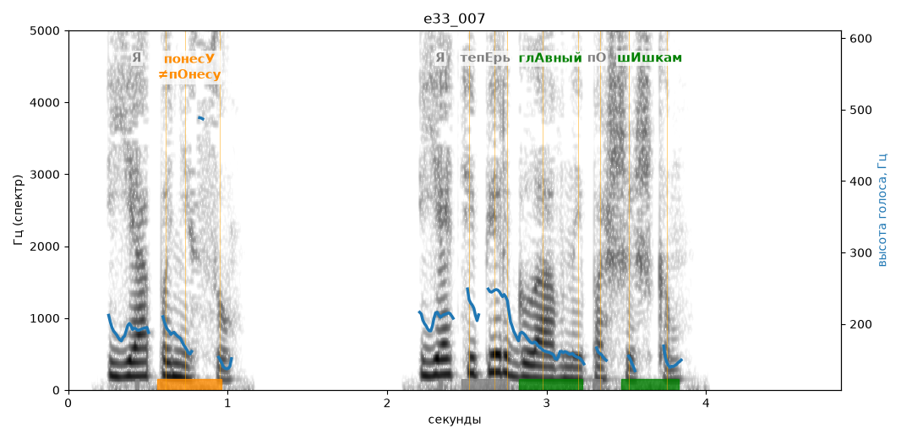

# e33_007

Голос: **edge:ru-RU-SvetlanaNeural** · длительность 4.8 с
Естественность (UTMOS): **4.14 из 5** (живой диктор ≈ 4–4.5)
Эталон: Я понесу. Я теперь главный по шишкам.
Распознано: Я понесу. Я теперь главный пошишкам.
Расхождения в словах: «по шишкам» → «пошишкам»

## Ударения
(где нужно: ruaccent)

| слово | нужно | у голоса | |
|---|---|---|---|
| понесу | понесУ | пОнесу | ✗? возможно — послушать |
| теперь | тепЕрь | — | ? |
| главный | глАвный | глАвный | ✓ |
| шишкам | шИшкам | шИшкам | ✓ |

## Интонация
- ✓ «я понесу.» — конец фразы понижается — звучит законченно
- ✓ «я теперь главный по шишкам.» — конец фразы понижается — звучит законченно
- Диапазон голоса 9.6 полутонов (живо), средняя высота 183 Гц

## Паузы и темп
- паузы на своих местах
- Темп 5.4 слога/с (нормально)

_Синяя линия — высота голоса. Над словами заглавная буква — где ударение должно быть; красным — голос поставил не туда (уверенно), оранжевым — возможно._
