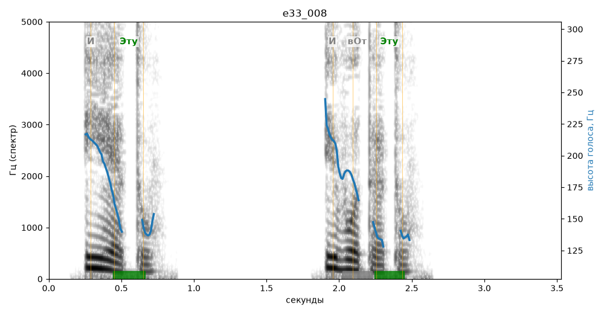

# e33_008

Голос: **edge:ru-RU-SvetlanaNeural** · длительность 3.5 с
Естественность (UTMOS): **3.45 из 5** (живой диктор ≈ 4–4.5)
Эталон: И эту. И вот эту!
Распознано: и эту и вот эту
Слова: все совпали

## Ударения
(где нужно: ruaccent)

| слово | нужно | у голоса | |
|---|---|---|---|
| эту | Эту | Эту | ✓ |
| эту | Эту | Эту | ✓ |

## Интонация
- ✗ «и эту.» — конец фразы не понижается — звучит незаконченно / как перечисление
- ✓ «и вот эту!» — выделено слово «и» (+5.0 пт)
- Диапазон голоса 8.3 полутонов (живо), средняя высота 180 Гц

## Паузы и темп
- паузы на своих местах
- Темп 7.9 слога/с (быстро)

_Синяя линия — высота голоса. Над словами заглавная буква — где ударение должно быть; красным — голос поставил не туда (уверенно), оранжевым — возможно._
