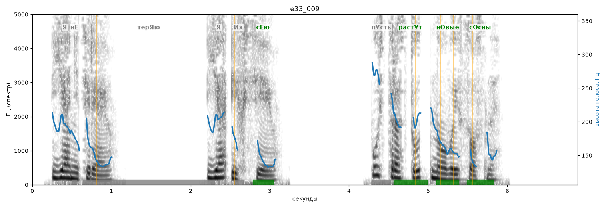

# e33_009

Голос: **edge:ru-RU-SvetlanaNeural** · длительность 6.9 с
Естественность (UTMOS): **3.87 из 5** (живой диктор ≈ 4–4.5)
Эталон: Я не теряю. Я их сею. Пусть растут новые сосны.
Распознано: Я не теряю. Я их сею. Пусть растут новые сосны.
Слова: все совпали

## Ударения
(где нужно: ruaccent)

| слово | нужно | у голоса | |
|---|---|---|---|
| теряю | терЯю | — | ? |
| сею | сЕю | сЕю | ✓ |
| растут | растУт | растУт | ✓ |
| новые | нОвые | нОвые | ✓ |
| сосны | сОсны | сОсны | ✓ |

## Интонация
- ✓ «я не теряю.» — конец фразы понижается — звучит законченно
- ✓ «пусть растут новые сосны.» — конец фразы понижается — звучит законченно
- Диапазон голоса 9.9 полутонов (живо), средняя высота 173 Гц

## Паузы и темп
- после «теряю.» пауза всего 0.04 с — фразы слипаются
- Темп 3.2 слога/с (медленно)

_Синяя линия — высота голоса. Над словами заглавная буква — где ударение должно быть; красным — голос поставил не туда (уверенно), оранжевым — возможно._
