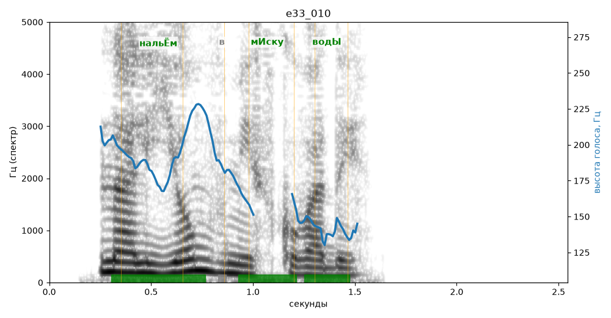

# e33_010

Голос: **edge:ru-RU-SvetlanaNeural** · длительность 2.5 с
Естественность (UTMOS): **4.13 из 5** (живой диктор ≈ 4–4.5)
Эталон: Нальём в миску воды.
Распознано: Нальем в миску воды.
Слова: все совпали

## Ударения
(где нужно: ruaccent)

| слово | нужно | у голоса | |
|---|---|---|---|
| нальём | нальЁм | нальЁм | ✓ |
| миску | мИску | мИску | ✓ |
| воды | водЫ | водЫ | ✓ |

## Интонация
- ✓ «нальём в миску воды.» — конец фразы понижается — звучит законченно
- Диапазон голоса 8.5 полутонов (живо), средняя высота 181 Гц

## Паузы и темп
- паузы на своих местах
- Темп 6.0 слога/с (нормально)

_Синяя линия — высота голоса. Над словами заглавная буква — где ударение должно быть; красным — голос поставил не туда (уверенно), оранжевым — возможно._
