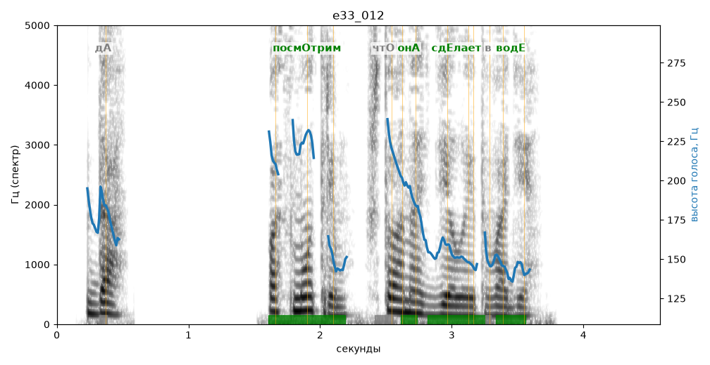

# e33_012

Голос: **edge:ru-RU-SvetlanaNeural** · длительность 4.6 с
Естественность (UTMOS): **3.8 из 5** (живой диктор ≈ 4–4.5)
Эталон: Да. Посмотрим, что она сделает в воде.
Распознано: Да. Посмотрим, что она сделает в воде.
Слова: все совпали

## Ударения
(где нужно: ruaccent)

| слово | нужно | у голоса | |
|---|---|---|---|
| посмотрим | посмОтрим | посмОтрим | ✓ |
| она | онА | онА | ✓ |
| сделает | сдЕлает | сдЕлает | ✓ |
| воде | водЕ | водЕ | ✓ |

## Интонация
- ✓ «посмотрим что она сделает в воде.» — конец фразы понижается — звучит законченно
- Диапазон голоса 8.3 полутонов (живо), средняя высота 160 Гц

## Паузы и темп
- паузы на своих местах
- Темп 7.3 слога/с (быстро)

_Синяя линия — высота голоса. Над словами заглавная буква — где ударение должно быть; красным — голос поставил не туда (уверенно), оранжевым — возможно._
