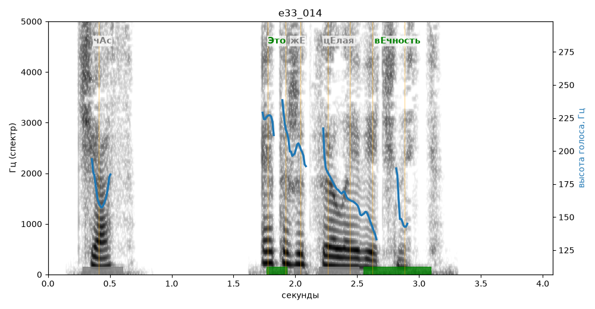

# e33_014

Голос: **edge:ru-RU-SvetlanaNeural** · длительность 4.1 с
Естественность (UTMOS): **3.89 из 5** (живой диктор ≈ 4–4.5)
Эталон: Час? Это же целая вечность!
Распознано: Час. Это же целая вечность.
Слова: все совпали

## Ударения
(где нужно: ruaccent)

| слово | нужно | у голоса | |
|---|---|---|---|
| это | Это | Это | ✓ |
| целая | цЕлая | — | ? |
| вечность | вЕчность | вЕчность | ✓ |

## Интонация
- ✓ «это же целая вечность!» — выделено слово «это» (+3.9 пт)
- Диапазон голоса 8.0 полутонов (живо), средняя высота 172 Гц

## Паузы и темп
- паузы на своих местах
- Темп 4.9 слога/с (нормально)

_Синяя линия — высота голоса. Над словами заглавная буква — где ударение должно быть; красным — голос поставил не туда (уверенно), оранжевым — возможно._
