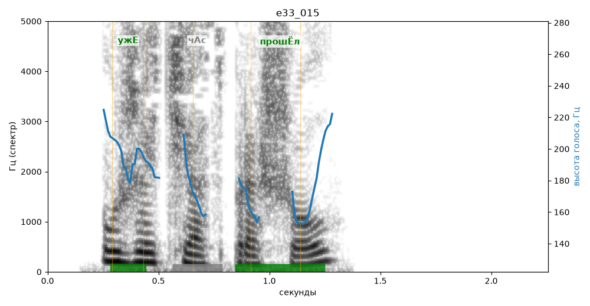

# e33_015

Голос: **edge:ru-RU-SvetlanaNeural** · длительность 2.3 с
Естественность (UTMOS): **3.54 из 5** (живой диктор ≈ 4–4.5)
Эталон: Уже час прошёл?
Распознано: Уже час прошел?
Слова: все совпали

## Ударения
(где нужно: ruaccent)

| слово | нужно | у голоса | |
|---|---|---|---|
| уже | ужЕ | ужЕ | ✓ |
| прошёл | прошЁл | прошЁл | ✓ |

## Интонация
- ✗ «уже час прошёл?» — нет вопросительного подъёма (самое высокое место — «уже», в начале) — звучит как утверждение
- Диапазон голоса 5.8 полутонов (нормально), средняя высота 182 Гц

## Паузы и темп
- паузы на своих местах
- Темп 5.2 слога/с (нормально)

_Синяя линия — высота голоса. Над словами заглавная буква — где ударение должно быть; красным — голос поставил не туда (уверенно), оранжевым — возможно._
