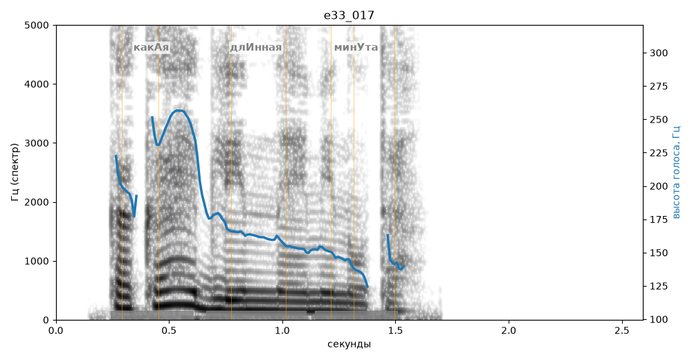

# e33_017

Голос: **edge:ru-RU-SvetlanaNeural** · длительность 2.6 с
Естественность (UTMOS): **3.95 из 5** (живой диктор ≈ 4–4.5)
Эталон: Какая длинная минута.
Распознано: Какая длинная минута.
Слова: все совпали

## Ударения
(где нужно: ruaccent)

| слово | нужно | у голоса | |
|---|---|---|---|
| какая | какАя | — | ? |
| длинная | длИнная | — | ? |
| минута | минУта | мИнута | ? не разобрать |

## Интонация
- ✓ «какая длинная минута.» — конец фразы понижается — звучит законченно
- Диапазон голоса 10.6 полутонов (живо), средняя высота 163 Гц

## Паузы и темп
- паузы на своих местах
- Темп 5.5 слога/с (нормально)

_Синяя линия — высота голоса. Над словами заглавная буква — где ударение должно быть; красным — голос поставил не туда (уверенно), оранжевым — возможно._
