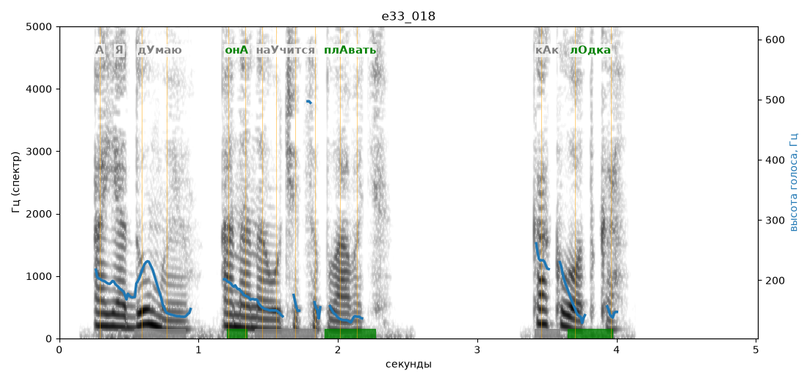

# e33_018

Голос: **edge:ru-RU-SvetlanaNeural** · длительность 5.0 с
Естественность (UTMOS): **3.82 из 5** (живой диктор ≈ 4–4.5)
Эталон: А я думаю, она научится плавать. Как лодка!
Распознано: А я думаю, она научится плавать. Как лодка.
Слова: все совпали

## Ударения
(где нужно: ruaccent)

| слово | нужно | у голоса | |
|---|---|---|---|
| думаю | дУмаю | — | ? |
| она | онА | онА | ✓ |
| научится | наУчится | научитсЯ | ? не разобрать |
| плавать | плАвать | плАвать | ✓ |
| лодка | лОдка | лОдка | ✓ |

## Интонация
- ✓ «а я думаю она научится плавать.» — конец фразы понижается — звучит законченно
- ✓ «как лодка!» — выделено слово «как» (+6.2 пт)
- Диапазон голоса 9.3 полутонов (живо), средняя высота 168 Гц

## Паузы и темп
- паузы на своих местах
- Темп 6.2 слога/с (нормально)

_Синяя линия — высота голоса. Над словами заглавная буква — где ударение должно быть; красным — голос поставил не туда (уверенно), оранжевым — возможно._
