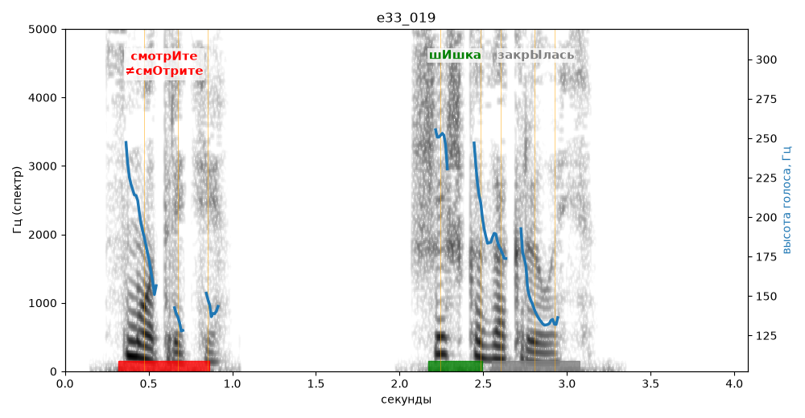

# e33_019

Голос: **edge:ru-RU-SvetlanaNeural** · длительность 4.1 с
Естественность (UTMOS): **3.94 из 5** (живой диктор ≈ 4–4.5)
Эталон: Смотрите! Шишка закрылась!
Распознано: Смотрите. Шишка закрылась.
Слова: все совпали

## Ударения
(где нужно: ruaccent)

| слово | нужно | у голоса | |
|---|---|---|---|
| смотрите | смотрИте | смОтрите | ✗ ОШИБКА |
| шишка | шИшка | шИшка | ✓ |
| закрылась | закрЫлась | зАкрылась | ? не разобрать |

## Интонация
- ✗ «смотрите!» — восклицание звучит ровно, без эмоции
- ✓ «шишка закрылась!» — выделено слово «шишка» (+5.5 пт)
- Диапазон голоса 11.1 полутонов (живо), средняя высота 175 Гц

## Паузы и темп
- паузы на своих местах
- Темп 5.5 слога/с (нормально)

_Синяя линия — высота голоса. Над словами заглавная буква — где ударение должно быть; красным — голос поставил не туда (уверенно), оранжевым — возможно._
