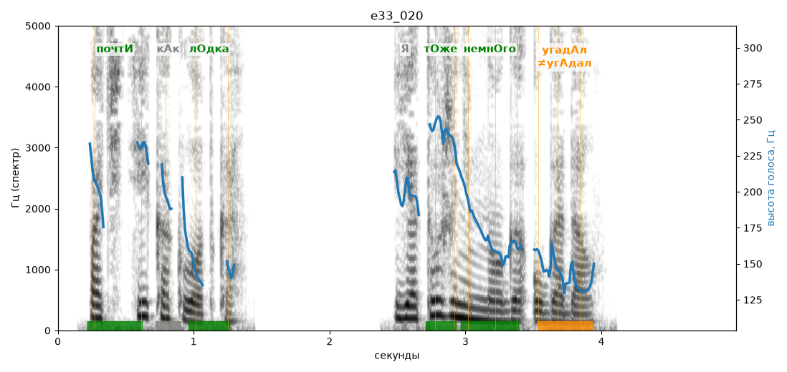

# e33_020

Голос: **edge:ru-RU-SvetlanaNeural** · длительность 5.0 с
Естественность (UTMOS): **4.08 из 5** (живой диктор ≈ 4–4.5)
Эталон: Почти как лодка. Я тоже немного угадал.
Распознано: Почти как лодка. Я тоже немного угадал.
Слова: все совпали

## Ударения
(где нужно: ruaccent)

| слово | нужно | у голоса | |
|---|---|---|---|
| почти | почтИ | почтИ | ✓ |
| лодка | лОдка | лОдка | ✓ |
| тоже | тОже | тОже | ✓ |
| немного | немнОго | немнОго | ✓ |
| угадал | угадАл | угАдал | ✗? возможно — послушать |

## Интонация
- ✓ «почти как лодка.» — конец фразы понижается — звучит законченно
- ✓ «я тоже немного угадал.» — конец фразы понижается — звучит законченно
- Диапазон голоса 10.4 полутонов (живо), средняя высота 169 Гц

## Паузы и темп
- паузы на своих местах
- Темп 5.4 слога/с (нормально)

_Синяя линия — высота голоса. Над словами заглавная буква — где ударение должно быть; красным — голос поставил не туда (уверенно), оранжевым — возможно._
