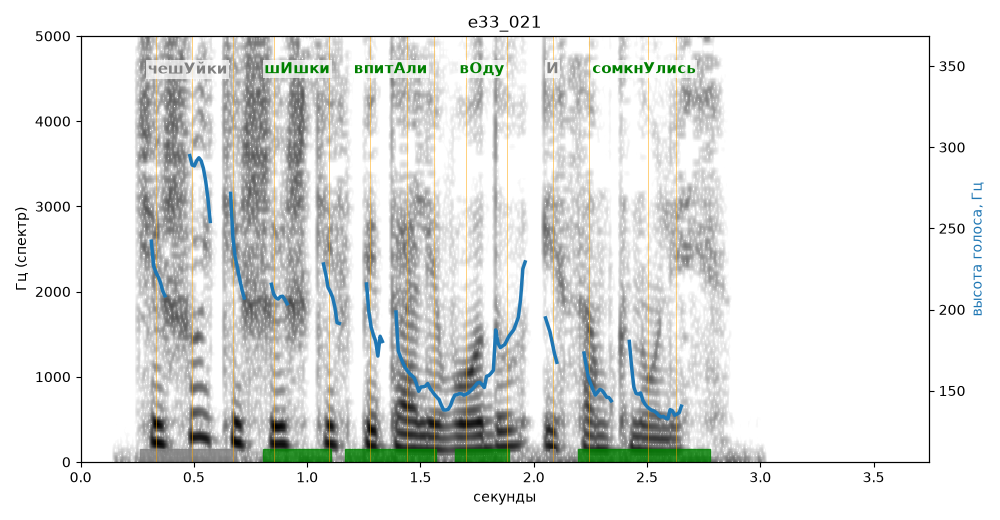

# e33_021

Голос: **edge:ru-RU-SvetlanaNeural** · длительность 3.7 с
Естественность (UTMOS): **3.97 из 5** (живой диктор ≈ 4–4.5)
Эталон: Чешуйки шишки впитали воду и сомкнулись.
Распознано: Чешуйки шишки впитали воду и самкнулись.
Расхождения в словах: «сомкнулись» → «самкнулись»

## Ударения
(где нужно: ruaccent)

| слово | нужно | у голоса | |
|---|---|---|---|
| чешуйки | чешУйки | чешуйкИ | ? не разобрать |
| шишки | шИшки | шИшки | ✓ |
| впитали | впитАли | впитАли | ✓ |
| воду | вОду | вОду | ✓ |
| сомкнулись | сомкнУлись | сомкнУлись | ✓ |

## Интонация
- ✓ «чешуйки шишки впитали воду и сомкнулись.» — конец фразы понижается — звучит законченно
- Диапазон голоса 12.2 полутонов (живо), средняя высота 165 Гц

## Паузы и темп
- паузы на своих местах
- Темп 6.0 слога/с (нормально)

_Синяя линия — высота голоса. Над словами заглавная буква — где ударение должно быть; красным — голос поставил не туда (уверенно), оранжевым — возможно._
