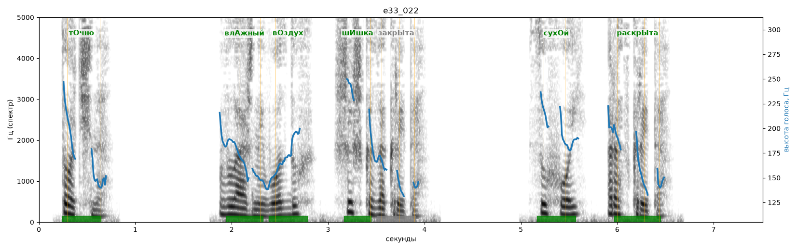

# e33_022

Голос: **edge:ru-RU-SvetlanaNeural** · длительность 7.5 с
Естественность (UTMOS): **3.82 из 5** (живой диктор ≈ 4–4.5)
Эталон: Точно. Влажный воздух — шишка закрыта. Сухой — раскрыта.
Распознано: Точно! Влажный воздух, шишка закрыта. Сухой, раскрыта.
Слова: все совпали

## Ударения
(где нужно: ruaccent)

| слово | нужно | у голоса | |
|---|---|---|---|
| точно | тОчно | тОчно | ✓ |
| влажный | влАжный | влАжный | ✓ |
| воздух | вОздух | вОздух | ✓ |
| шишка | шИшка | шИшка | ✓ |
| закрыта | закрЫта | зАкрыта | ? не разобрать |
| сухой | сухОй | сухОй | ✓ |
| раскрыта | раскрЫта | раскрЫта | ✓ |

## Интонация
- ✓ «влажный воздух шишка закрыта.» — конец фразы понижается — звучит законченно
- ✓ «сухой раскрыта.» — конец фразы понижается — звучит законченно
- Диапазон голоса 8.5 полутонов (живо), средняя высота 171 Гц

## Паузы и темп
- паузы на своих местах
- Темп 5.6 слога/с (нормально)

_Синяя линия — высота голоса. Над словами заглавная буква — где ударение должно быть; красным — голос поставил не туда (уверенно), оранжевым — возможно._
